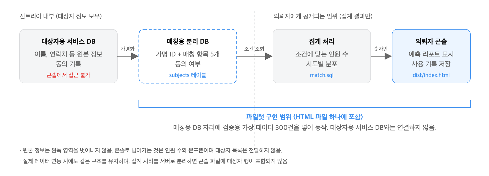

# STAR-C 파일럿 콘솔 데이터 스키마 정의서

| 항목 | 내용 |
|---|---|
| 문서 | 데이터 스키마 정의서 (매칭 변수 정의 포함) |
| 대상 | STAR-C 의뢰자용 모집 가능성 예측 콘솔 파일럿 |
| 작성일 | 2026-10-27 |
| 버전 | 1.0 (초안) |

## 1. 목적과 범위

- 파일럿 콘솔이 사용하는 데이터의 구조, 항목, 허용값을 정의함
- 매칭에 쓰이는 변수 5종을 명시하고, 실제 데이터를 투입할 때 지켜야 할 규격을 제시함
- 파일럿은 실제 대상자 DB와 연동하지 않으며, 검증용 가상 데이터 300건으로 동작함
- 원본 정의는 소스의 `src/db/schema.sql`이며, 본 문서는 그 내용을 설명한 것임

## 2. 데이터 구성

콘솔은 성격이 다른 데이터 세 가지를 따로 둠. 하나로 합치지 않음.

| 구분 | 위치 | 내용 | 변경 주체 |
|---|---|---|---|
| 원본 파일 | `data/synthetic.csv`, `data/params.csv` | 대상자 300건, 질환별 비율 | 생성 스크립트로만 생성. 콘솔은 읽기만 함 |
| 조회용 DB | 브라우저 메모리의 SQLite | 매칭과 집계 쿼리 실행 | 콘솔을 열 때 원본 파일을 적재 |
| 사용 기록 | 브라우저 저장소(localStorage) | 권한 전환, 조회, 내보내기 이력 | 콘솔이 추가. CSV 내보내기 제공 |

- 원본 파일은 빌드 시 콘솔 파일(`dist/index.html`) 안에 포함됨. 따라서 데이터를 바꾸면 다시 빌드해야 반영됨
- 사용 기록은 PC와 브라우저별로 따로 저장됨. 다른 PC에서는 보이지 않음

## 3. 대상자 테이블 `subjects`

가명 ID와 매칭 변수만 가짐. 이름, 연락처 등 식별 정보는 두지 않음.

| 항목 | 자료형 | 허용값 | 필수 | 매칭 변수 | 설명 |
|---|---|---|---|---|---|
| subject_id | 문자 | `VS-0001` 형식의 가명 ID | 필수, 고유 | — | 원본 DB의 개인과 연결하는 키. 콘솔 화면에는 표시하지 않음 |
| age | 정수 | 19 이상 | 필수 | ● 연령 | 만 나이. 입력 화면의 10세 구간과 비교 |
| sex | 코드 | `M`, `F` | 필수 | ● 성별 | M 남성, F 여성 |
| sido_code | 코드 | 행정표준코드 2자리 (4.1절) | 필수 | ● 거주지역 | 거주 시도 |
| health_status | 코드 | `건강인`, `환자` | 필수 | ● 건강상태 | 환자는 질환 카테고리를 가짐 |
| disease_category | 코드 | 질환 6종 (4.3절) | 환자만 | ● 질환 | 건강인은 비워 둠 |
| disease_detail | 문자 | 자유 입력 | 기타만 | 보조 | disease_category가 `기타`일 때의 질환명 |
| consent_matching | 정수 | `1` 동의, `0` 미동의 | 필수 | 사전 조건 | 1인 대상자만 매칭 대상. 0은 모든 조회에서 제외 |

- 매칭 변수는 5종: 연령, 성별, 거주지역, 건강상태, 질환
- `disease_detail`은 매칭 변수가 아니며, 입력 화면에서 `기타`를 고르고 질환명을 적었을 때만 부분 일치로 보조 조건이 됨
- 제약: sex, health_status, consent_matching은 허용값 외의 값이 들어오면 적재 시 오류

## 4. 파라미터 테이블 `params`

예상 등록 인원 계산에 쓰는 질환별 비율. 값은 가상 시나리오 값임.

| 항목 | 자료형 | 설명 |
|---|---|---|
| key | 문자 | 질환 카테고리 6종 또는 `건강인` |
| response_rate | 실수 | 예상 반응률 (0~1) |
| screening_pass_rate | 실수 | 예상 스크리닝 통과율 (0~1) |

현재 값:

| key | 반응률 | 통과율 |
|---|---|---|
| 고혈압 | 0.45 | 0.65 |
| 이상지질혈증 | 0.45 | 0.65 |
| 당뇨병 | 0.40 | 0.55 |
| 아토피피부염 | 0.50 | 0.60 |
| 건선 | 0.45 | 0.55 |
| 기타 | 0.35 | 0.50 |
| 건강인 | 0.50 | 0.70 |

## 5. 코드표

### 5.1 시도 (행정표준코드)

권역은 권장 실시기관의 접근성 계산에 쓰임. 입력 화면에는 부산, 경남이 맨 앞에 나옴.

| 코드 | 시도 | 약칭 | 권역 |
|---|---|---|---|
| 26 | 부산광역시 | 부산 | 동남권 |
| 48 | 경상남도 | 경남 | 동남권 |
| 31 | 울산광역시 | 울산 | 동남권 |
| 11 | 서울특별시 | 서울 | 수도권 |
| 27 | 대구광역시 | 대구 | 대경권 |
| 28 | 인천광역시 | 인천 | 수도권 |
| 29 | 광주광역시 | 광주 | 호남권 |
| 30 | 대전광역시 | 대전 | 충청권 |
| 36 | 세종특별자치시 | 세종 | 충청권 |
| 41 | 경기도 | 경기 | 수도권 |
| 51 | 강원특별자치도 | 강원 | 강원권 |
| 43 | 충청북도 | 충북 | 충청권 |
| 44 | 충청남도 | 충남 | 충청권 |
| 52 | 전북특별자치도 | 전북 | 호남권 |
| 46 | 전라남도 | 전남 | 호남권 |
| 47 | 경상북도 | 경북 | 대경권 |
| 50 | 제주특별자치도 | 제주 | 제주권 |

### 5.2 연령 구간

| 구간 ID | 표시 | 만 나이 범위 |
|---|---|---|
| 19-29 | 19~29세 | 19 ~ 29 |
| 30-39 | 30~39세 | 30 ~ 39 |
| 40-49 | 40~49세 | 40 ~ 49 |
| 50-59 | 50~59세 | 50 ~ 59 |
| 60-69 | 60~69세 | 60 ~ 69 |
| 70+ | 70세 이상 | 70 이상 |

### 5.3 질환 카테고리

| 코드값 | 비고 |
|---|---|
| 고혈압 | |
| 이상지질혈증 | |
| 당뇨병 | |
| 아토피피부염 | |
| 건선 | |
| 기타 | `disease_detail`에 질환명을 둠 |

### 5.4 그 밖의 코드

| 항목 | 값 |
|---|---|
| 성별 (sex) | `M` 남성, `F` 여성. 입력 화면의 `성별무관`은 저장값이 아니라 조회 옵션임 |
| 건강상태 (health_status) | `건강인`, `환자` |
| 매칭 동의 (consent_matching) | `1` 동의, `0` 미동의 |

## 6. 검증용 가상 데이터셋

### 6.1 생성 규칙

- 생성 스크립트 `scripts/gen-synthetic.ts`로 한 번 생성하여 `data/synthetic.csv`로 저장함. 콘솔 실행 시 다시 만들지 않음
- 난수 시드 20261022를 고정하여 언제 생성해도 같은 300건이 나옴
- 분포 가중치: 환자 74%, 질환은 고혈압 30% · 이상지질혈증 22% · 당뇨병 20% · 아토피피부염 11% · 건선 8% · 기타 9%, 지역은 부산 44% · 경남 22% · 울산 8% 중심
- 연령은 환자군은 50~60대, 건강인과 아토피피부염은 20~30대에 치우치도록 설정
- 가상 데이터는 전원 매칭 동의(`consent_matching = 1`)

### 6.2 구성 (300건)

| 구분 | 내용 |
|---|---|
| 건강상태 | 환자 224, 건강인 76 |
| 성별 | 남성 148, 여성 152 |
| 연령 | 19~29세 54, 30~39세 40, 40~49세 46, 50~59세 64, 60~69세 73, 70세 이상 23 (최소 19세, 최대 84세) |
| 질환 (환자 224) | 고혈압 72, 이상지질혈증 50, 당뇨병 36, 아토피피부염 33, 건선 19, 기타 14 |
| 기타 질환명 (14) | 천식 5, 골관절염 4, 통풍 3, 만성콩팥병 2 |
| 지역 상위 | 부산 119, 경남 79, 울산 24, 경기 17, 서울 12, 대구 12, 경북 11 |
| 지역 0건 | 세종, 충남 |

## 7. 실제 데이터 투입 규격

실제 대상자 데이터는 아래 규격의 CSV로 준비하면 콘솔 로직 수정 없이 적용 가능함.

- 파일: `data/synthetic.csv`를 같은 이름으로 교체. 인코딩 UTF-8, 첫 줄은 항목명
- 항목 순서: `subject_id, age, sex, sido_code, health_status, disease_category, disease_detail, consent_matching`
- 값이 없는 칸은 비워 둠 (건강인의 disease_category, 기타가 아닌 경우의 disease_detail)
- 값 안에 쉼표나 따옴표를 쓰지 않음 (질환명에 쉼표가 필요하면 다른 구분자로 대체)
- subject_id는 원본 DB의 개인과 1:1로 대응하는 가명이어야 하며, 콘솔에는 개인을 알 수 있는 값을 넣지 않음
- consent_matching이 0인 행도 포함 가능. 매칭에서는 자동으로 제외됨
- `data/params.csv`의 비율도 함께 확정값으로 교체
- 교체 후 `npm run build`로 다시 빌드해야 콘솔 파일에 반영됨

주의: 현재 구조에서는 CSV 내용이 콘솔 파일 안에 포함됨. 콘솔 파일을 외부(의뢰자)에 배포하는 경우 집계 처리를 서버로 분리해야 함 (9절 참고).

## 8. 사용 기록 레코드

| 항목 | 내용 |
|---|---|
| 시각 | `YYYY-MM-DD HH:MM:SS` |
| 권한 | 의뢰자 / 관리자 |
| 동작 | 예측 조회, 권한 전환, 설정 변경, 로그 내보내기 |
| 내용 | 조회 조건과 집계값 (예: `50~59세 / 남성 / 환자 / 고혈압 / 부산, 경남, 울산 / 목표 3명 → 매칭 10명, 예상 등록 2.9명`) |

- 대상자 ID나 개인 정보는 기록하지 않음
- 최근 200건까지 보관, 화면에는 최근 40건 표시
- CSV 내보내기 파일명 `starc-logs-YYYYMMDD-HHMMSS.csv`, 엑셀에서 바로 열리도록 UTF-8 BOM 포함

## 9. 원본 DB와 콘솔 DB 분리 구조



- 대상자용 서비스 DB: 이름, 연락처 등 원본 정보와 동의 기록. 콘솔에서 접근하지 않음
- 매칭용 분리 DB: 가명 ID와 매칭 변수 5종, 동의 여부만 보관 (3절의 `subjects`)
- 집계 처리: 조건에 맞는 인원 수와 시도별 분포만 계산 (`match.sql`)
- 의뢰자 콘솔: 집계된 숫자로 리포트를 만들고 사용 기록을 남김

파일럿 적용

- 매칭용 분리 DB 자리에 검증용 가상 데이터 300건을 두고, 집계 처리와 콘솔을 HTML 파일 하나에 담아 동작함
- 대상자용 서비스 DB와는 연결하지 않음

실제 데이터 연동 시

- 매칭용 분리 DB와 집계 처리를 서버에 두고, 콘솔은 집계 결과만 받도록 분리하면 콘솔 파일에 대상자 행이 포함되지 않음
- 테이블 정의(`subjects`, `params`)와 매칭 쿼리(`match.sql`)는 그대로 사용 가능

## 10. 확정이 필요한 사항

- 가명 ID 부여 규칙 (원본 DB와의 대응 방식)
- 질환 카테고리 6종 외 질환의 표준 질환명 목록 (`기타`의 disease_detail 통일)
- `params` 비율의 확정값과 출처

## 부록 A. `schema.sql` 원문

```sql
-- 대상자 (data/synthetic.csv)
CREATE TABLE subjects (
  subject_id       TEXT    PRIMARY KEY,                                  -- 가명 식별자 (VS-0001 형식)
  age              INTEGER NOT NULL,                                     -- 만 나이 → 10세 구간으로 비교 [매칭: 연령]
  sex              TEXT    NOT NULL CHECK (sex IN ('M', 'F')),           -- [매칭: 성별]
  sido_code        TEXT    NOT NULL,                                     -- 행정표준코드 시·도 2자리 [매칭: 거주지역]
  health_status    TEXT    NOT NULL CHECK (health_status IN ('건강인', '환자')), -- [매칭: 건강상태]
  disease_category TEXT,                                                 -- 6개 카테고리, 건강인은 NULL [매칭: 질환카테고리]
  disease_detail   TEXT,                                                 -- 기타 카테고리의 세부 질환명 (기타 입력 시 보조)
  consent_matching INTEGER NOT NULL CHECK (consent_matching IN (0, 1))   -- 매칭 활용 동의 여부 (전처리 조건, 가상 데이터는 모두 1)
);

-- 질환별 고정 파라미터 (data/params.csv). key는 질환 카테고리 6종 + '건강인'.
CREATE TABLE params (
  key                 TEXT PRIMARY KEY,
  response_rate       REAL NOT NULL,   -- 예상 반응률
  screening_pass_rate REAL NOT NULL    -- 스크리닝 통과율
);
```
