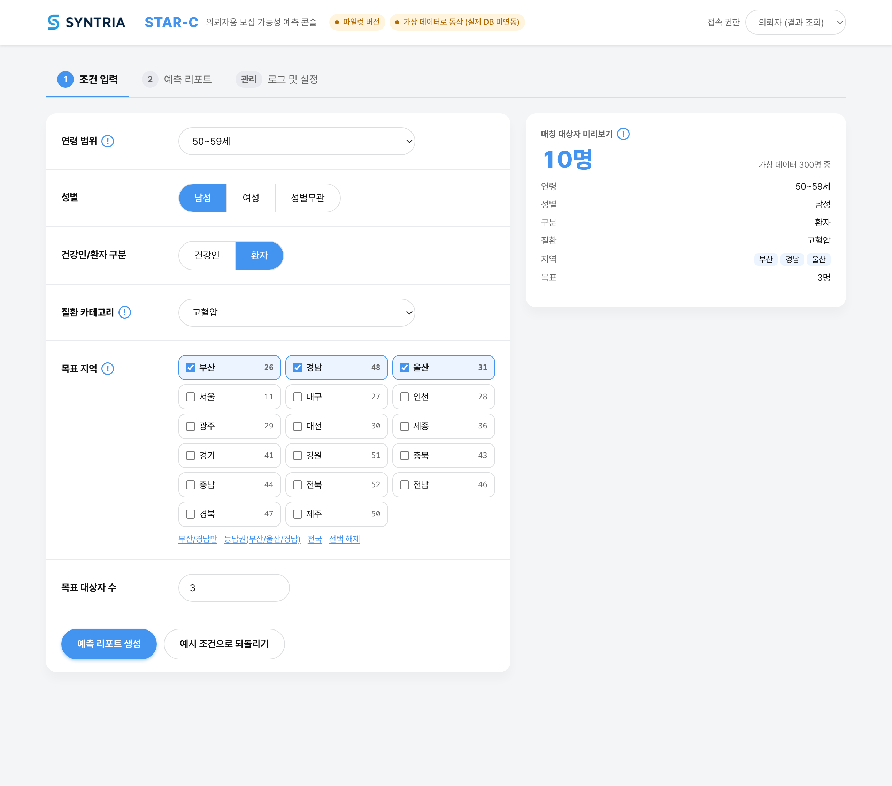
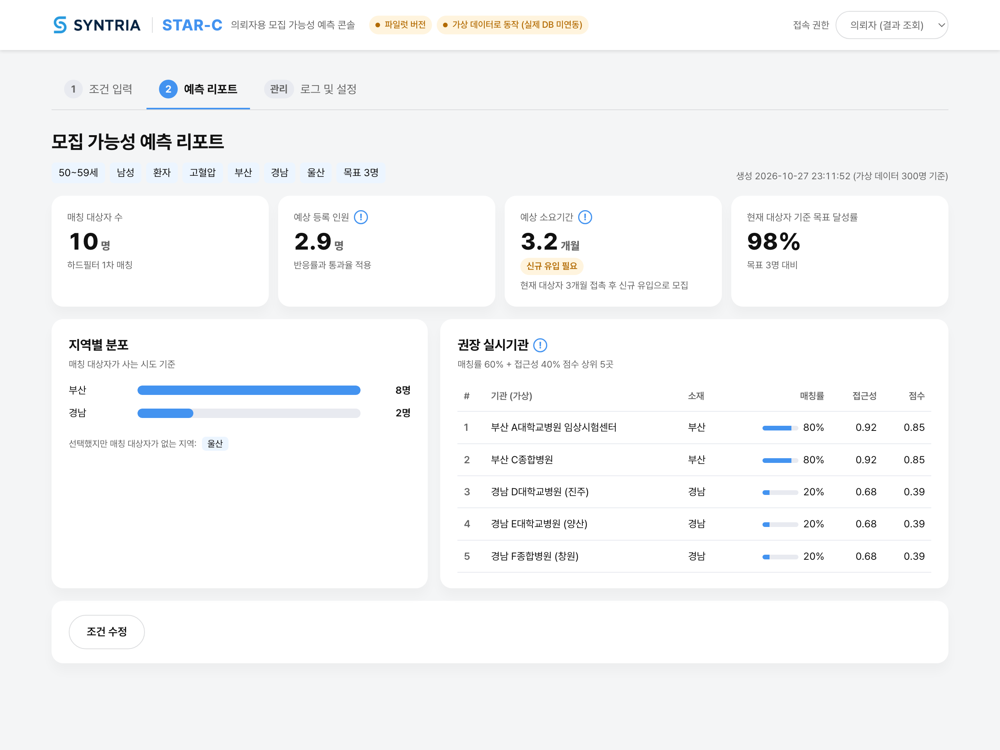
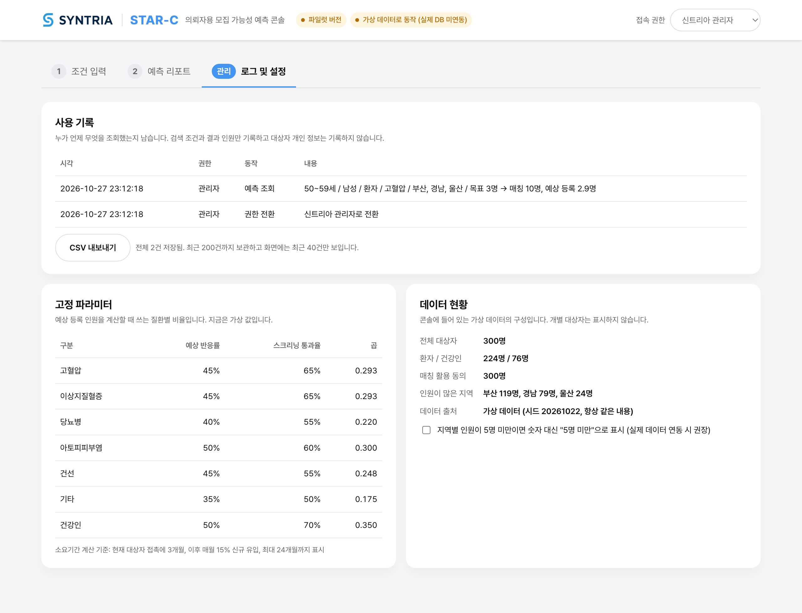

# STAR-C 파일럿 콘솔 기술 고도화 결과보고서

| 항목 | 내용 |
|---|---|
| 문서 | 기술 고도화 결과보고서 |
| 과제명 | 자가 기입 기반 사전 스크리닝 기술이 적용된 임상시험 의뢰자용 모집 가능성 예측·매칭 콘솔 서비스 |
| 과제 범위 | 화면 2종(조건 입력, 예측 리포트)의 하드필터 기반 매칭 로직 설계 및 파일럿 구현 |
| 수행 기간 | 2026년 10월 ~ 11월 |
| 작성일 | 2026-10-27 |
| 버전 | 1.0 (초안) |

## 1. 과제 개요

### 1.1 목적

- 임상시험 의뢰자가 프로토콜 조건을 입력하면, 대상자 풀과 대조하여 모집 가능 인원과 예상 소요기간을 예측해 주는 콘솔을 파일럿으로 구현함
- 파일럿은 실제 대상자 DB와 연동하지 않고 검증용 가상 데이터로 동작하며, 매칭 로직과 화면 흐름을 검증하는 데 목적을 둠

### 1.2 범위

| 구분 | 포함 | 제외 |
|---|---|---|
| 화면 | 조건 입력, 예측 리포트, 관리(사용 기록·설정) | — |
| 매칭 | 5개 변수 하드필터 | 자연어 선정·제외 기준 자동 해석, 참여 이력 가중 매칭(소프트 스코어링) |
| 예측 | 예상 등록 인원, 예상 소요기간, 권장 실시기관 | 실제 운영 데이터 기반 학습 |
| 데이터 | 검증용 가상 데이터 300건 | 실제 대상자 DB 연동 |
| 운영 | 접속 권한 구분, 사용 기록 | 로그인·계정 관리 |

## 2. 요구사항과 충족 결과

### 2.1 입력 화면

| 요구 항목 | 요구 내용 | 구현 | 충족 |
|---|---|---|---|
| 연령 범위 | 드롭다운, 10세 단위 6구간 | 19~29세 … 70세 이상 6구간 드롭다운 | ○ |
| 성별 | 라디오, 남성/여성 | 남성 / 여성 / 성별무관 (성별무관은 추가 요청으로 반영) | ○ |
| 질환 카테고리 | 드롭다운 단일 선택, 6종 + 기타 직접입력 | 6종 드롭다운, 기타 선택 시 질환명 입력란 표시 | ○ |
| 건강인/환자 구분 | 라디오 | 건강인 / 환자. 건강인 선택 시 질환 조건 미적용 안내 | ○ |
| 목표 지역 | 17개 시도 다중 선택, 부산·경남 상단 | 체크박스 17개, 부산·경남 맨 앞. 부산/경남만, 동남권, 전국 바로가기 | ○ |
| 목표 대상자 수 | 1 이상 정수 직접 입력 | 숫자 입력, 1 미만·비정수는 오류 표시 | ○ |

### 2.2 결과(예측 리포트) 화면

| 요구 항목 | 구현 | 충족 |
|---|---|---|
| 매칭 대상자 수 | 하드필터 1차 매칭 인원 | ○ |
| 예상 등록 인원 | 매칭 대상자 수 × 반응률 × 통과율. 계산식을 화면에서 확인 가능 | ○ |
| 지역별 분포 | 시도별 인원 막대그래프. 5명 미만 가림 옵션 | ○ |
| 예상 소요기간 | 목표 인원 달성까지 개월 수와 판정(현재 대상자로 달성 / 신규 유입 필요 / 달성 곤란) | ○ |
| 권장 실시기관 리스트 | 매칭률·접근성 점수 상위 5곳 | ○ |

### 2.3 매칭·예측 로직

| 요구 내용 | 구현 | 충족 |
|---|---|---|
| 하드필터 변수: 연령, 성별, 거주지역, 질환카테고리, 건강상태 | 5변수 AND 조건 SQL 쿼리 (`match.sql`) | ○ |
| 예측 공식: 매칭 수 × 반응률 × 통과율 | 동일 공식 적용 | ○ |
| 반응률·통과율은 고정 파라미터 | `params.csv`에 질환별 7개 값. 관리 화면에서 확인 가능 | ○ |
| 검증용 가상 데이터셋 100~300건 | 300건 생성, 시드 고정으로 재현 가능 | ○ |
| 하드필터로 한정, 소프트 스코어링·자연어 파싱 보류 | 미구현 (범위 제외) | ○ |

### 2.4 데이터·보안

| 요구 내용 | 구현 | 충족 |
|---|---|---|
| 실 대상자 DB와 미연동, 가상 데이터로만 동작 | 가상 데이터 300건을 콘솔 파일에 포함. 외부 통신 없음 | ○ |
| 콘솔은 결과값만 조회, 원본 개인정보 비접근 | 대상자 테이블에 가명 ID와 매칭 변수만 존재. 화면과 기록에 개별 대상자 미표시 | ○ |
| 접근 권한 관리와 로그 기반 사용 이력 | 의뢰자/관리자 권한 구분, 사용 기록 저장과 CSV 내보내기 | ○ |
| 실 데이터 연동 시 별도 DB로 분리되는 구조 | 원본 DB / 매칭용 분리 DB / 집계 / 콘솔의 4단계 구조로 설계 (스키마 정의서 9절) | ○ |

## 3. 결과물

| 구분 | 파일 | 내용 |
|---|---|---|
| 파일럿 콘솔 | `dist/index.html` | 단일 HTML 파일(약 4.2MB). 더블클릭으로 실행 |
| 데이터 | `data/synthetic.csv`, `data/params.csv` | 가상 데이터 300건, 질환별 비율 |
| 스키마·로직 | `src/db/schema.sql`, `src/db/match.sql` | 테이블 정의, 매칭 쿼리 |
| 소스 | `src/`, `scripts/`, 빌드 설정 | TypeScript 소스 전체, 데이터 생성 스크립트 |
| 문서 | 데이터 스키마 정의서, 매칭 로직 설명서, 본 보고서, 설치 안내(README) | |

## 4. 시스템 구성

### 4.1 구성 방식

- 서버 없이 HTML 파일 하나로 동작함. 화면, 매칭 로직, 데이터, 글꼴이 모두 파일 안에 포함됨
- 인터넷 연결 없이 PC에서 파일을 열면 실행됨. 외부 서버와 통신하지 않음
- 브라우저 안에서 SQLite 엔진(sql.js)을 실행하여 SQL로 매칭과 집계를 처리함

| 구성 요소 | 기술 | 비고 |
|---|---|---|
| 화면 | TypeScript, HTML, CSS | 프레임워크 없음 |
| 데이터베이스 | sql.js (SQLite, asm.js 빌드) | 파일(file://)로 열어도 동작하는 빌드 사용 |
| 빌드 | Vite, vite-plugin-singlefile | 결과물을 파일 하나로 합침 |
| 글꼴 | Pretendard (OFL) | 신트리아 홈페이지와 동일. 파일에 포함 |
| 사용 기록 저장 | 브라우저 localStorage | PC·브라우저별로 저장 |

### 4.2 데이터 흐름

- 콘솔을 열면 파일 안의 CSV를 메모리 DB의 `subjects`, `params` 테이블에 적재함
- 입력 화면에서 조건을 바꾸면 즉시 `match.sql`을 실행해 매칭 인원을 미리 보여 줌
- 리포트 생성 시 시도별 인원을 받아 예상 등록 인원, 소요기간, 기관 점수를 계산함
- 조회 결과는 조건과 집계값만 사용 기록에 남김

## 5. 화면 구성

### 5.1 조건 입력



- 왼쪽에서 조건 6개를 입력하고, 오른쪽 미리보기에서 매칭 인원을 바로 확인함
- 각 항목 옆 `!` 버튼으로 항목 설명을 볼 수 있음
- 예시 조건(50~59세, 남성, 고혈압, 부산·경남·울산, 목표 3명)이 기본으로 채워져 있음

### 5.2 예측 리포트



- 상단에 조회 조건과 생성 시각, 지표 4개(매칭 대상자 수, 예상 등록 인원, 예상 소요기간, 목표 달성률)
- 예상 등록 인원과 소요기간의 `!` 버튼으로 계산식과 가정을 확인 가능
- 하단에 지역별 분포 막대그래프와 권장 실시기관 상위 5곳
- 매칭 대상자가 10명 미만이거나 없을 때, 건강인을 선택했을 때는 안내 배너 표시

### 5.3 관리 (로그 및 설정)



- 접속 권한을 `신트리아 관리자`로 바꿔야 열림. 의뢰자 권한에서는 잠김 안내만 표시
- 사용 기록: 시각, 권한, 동작, 내용. CSV 내보내기 버튼
- 고정 파라미터: 질환별 반응률·통과율과 소요기간 계산 기준
- 데이터 현황: 가상 데이터 구성 요약과 5명 미만 가림 옵션

## 6. 수행 내용

### 6.1 검증용 가상 데이터 구축

- 대상자 300건을 생성 스크립트로 만들어 CSV로 고정함. 난수 시드를 고정하여 언제 생성해도 같은 데이터가 나옴
- 환자 224건, 건강인 76건. 질환은 고혈압, 이상지질혈증, 당뇨병 순으로 많고, 지역은 부산 119건, 경남 79건, 울산 24건 등 동남권 중심
- 구성 통계와 생성 규칙은 데이터 스키마 정의서 6절 참고

### 6.2 데이터 스키마 설계

- 대상자 테이블은 가명 ID와 매칭 변수 5종, 세부 질환명, 동의 여부의 8개 항목으로 구성
- 성별, 건강상태, 동의 여부는 허용값을 제약으로 걸어 잘못된 값이 들어오면 적재 단계에서 걸러짐
- 실제 데이터 투입 시 CSV 규격을 정의서 7절에 명시함

### 6.3 매칭 로직 구현

- 매칭과 집계를 SQL 쿼리 하나로 처리함. 화면 코드에서 대상자 행을 다루지 않음
- 동의자만 대상으로 하는 전처리 조건을 쿼리에 포함함
- 건강인 선택 시 질환 조건 제외, 성별무관 선택 시 성별 조건 제외, 기타 질환명 부분 일치 등 예외 규칙을 반영함
- 상세는 매칭 로직 설명서 3절 참고

### 6.4 예측 계산 구현

- 예상 등록 인원: 매칭 수 × 반응률 × 통과율
- 예상 소요기간: 현재 대상자 접촉 3개월, 이후 월 15% 신규 유입 가정으로 목표 달성 시점을 계산하고 24개월 상한 적용
- 권장 실시기관: 매칭률 60% + 접근성 40% 점수로 상위 5곳 선정. 가상 기관 10곳 사용
- 상세는 매칭 로직 설명서 4~6절 참고

### 6.5 권한 구분과 사용 기록

- 의뢰자 권한은 입력과 리포트만, 관리자 권한은 관리 화면까지 열림
- 권한 전환, 예측 조회, 설정 변경, 기록 내보내기를 시각과 함께 기록함. 조회 기록은 조건과 집계값만 남김
- 최근 200건 보관, CSV로 내보내기 가능

### 6.6 화면 디자인

- 신트리아 홈페이지의 색상, 글꼴(Pretendard), 모서리·그림자 스타일을 적용하여 같은 서비스로 보이도록 구성함
- 상단에 신트리아 로고 배치
- 항목 설명은 접어 두고 필요할 때 펼치는 방식으로 화면을 단순하게 유지함

## 7. 검증 결과

### 7.1 매칭·예측 로직 검증

| 검증 항목 | 방법 | 결과 |
|---|---|---|
| 가상 데이터 재현성 | 생성 스크립트 결과와 제공받은 프로토타입이 생성하는 300건을 행 단위 비교 | 완전 일치 |
| 매칭·예측 결과 | 조건 조합 50,184개에 대해 프로토타입과 매칭 수, 지역 분포, 등록 인원, 소요기간, 기관 점수 비교 | 모든 수치 일치. 동점 기관의 표시 순서만 12개 조건에서 다름(동점 기준을 명시한 결과) |
| 성별무관 | 96개 조건에서 남성 결과 + 여성 결과와 비교 | 전부 일치 |
| 동의 조건 | 일부 대상자를 미동의로 바꾸고 매칭 수 변화 확인 | 해당 인원만큼 제외됨 |

### 7.2 동작 검증

| 검증 항목 | 방법 | 결과 |
|---|---|---|
| 파일 단독 실행 | 빌드 파일을 인터넷 차단 상태에서 file://로 열어 확인 | 정상 동작, 외부 요청 없음 |
| 화면 흐름 | 조건 입력 → 리포트 생성 → 조건 수정, 권한 전환 → 관리 화면, 입력 오류 표시 | 정상 |
| 사용 기록 내보내기 | CSV 다운로드 후 내용과 인코딩 확인 | 정상. 엑셀에서 한글 깨짐 없음 |
| 글꼴 포함 | Pretendard 미설치 PC에서 글꼴 적용 여부 확인 | 적용됨 |
| Windows PC 설치 | 업무용 Windows PC에서 README 절차대로 실행 | (확인 후 기재) |

## 8. 보안·개인정보 보호 설계

- 콘솔에는 대상자를 알아볼 수 있는 정보가 없음. 가명 ID와 매칭 변수만 보관
- 화면에는 집계된 인원 수와 분포만 표시하고, 대상자 목록은 어떤 화면에도 나오지 않음
- 사용 기록에도 조건과 집계값만 남기며 대상자 ID를 기록하지 않음
- 지역별 분포에서 5명 미만 셀을 가리는 옵션을 제공하여 소수 인원의 간접 식별을 막을 수 있음
- 외부 서버와 통신하지 않으므로 데이터가 PC 밖으로 나가지 않음
- 실제 데이터 연동 시에는 매칭용 DB와 집계 처리를 서버로 분리하여 콘솔 파일에 대상자 행이 포함되지 않도록 함 (데이터 스키마 정의서 9절)

## 9. 설치와 사용

- 별도 설치 없이 `index.html` 파일을 더블클릭하면 Edge 또는 Chrome에서 열림
- Windows 10/11, 인터넷 연결 불필요
- 자세한 절차와 문제 해결은 README 참고

## 10. 한계와 고도화 방향

### 10.1 파일럿의 한계

| 항목 | 현재 | 영향 |
|---|---|---|
| 데이터 | 가상 데이터 300건 | 실제 모집 가능성과는 무관. 로직 검증 목적 |
| 반응률·통과율·소요기간 가정 | 가상 시나리오 값 | 예측 수치의 절대값은 참고용 |
| 실시기관 | 가상 10곳 | 실제 기관 목록과 수행 질환으로 교체 필요 |
| 데이터 배포 | 콘솔 파일 안에 데이터 포함 | 파일을 외부에 배포하면 데이터도 함께 전달됨 |
| 권한 | 화면에서 권한을 선택하는 방식 | 로그인이 없어 권한 구분이 형식적임 |
| 사용 기록 | PC·브라우저별 저장 | 여러 PC의 기록을 모으려면 CSV 내보내기 필요 |

### 10.2 고도화 방향

단기 (실제 데이터 연동 준비)

- 실제 대상자 데이터를 스키마 정의서 규격의 CSV로 준비하고, 반응률·통과율·소요기간 가정을 확정값으로 교체
- 실시기관 목록을 실제 기관과 수행 질환으로 교체
- 매칭용 DB와 집계 처리를 서버로 옮기고 콘솔은 집계 결과만 받도록 분리. 테이블 정의와 매칭 쿼리는 그대로 사용 가능

중기 (운영 기능)

- 로그인과 계정 기반 권한 관리, 서버 측 사용 기록 저장
- 데이터 갱신을 빌드 없이 반영하는 데이터 적재 기능
- 반응률·통과율을 실제 모집 결과로 갱신하는 피드백 구조

중장기 (매칭 고도화)

- 참여 이력, 응답 이력 등을 반영한 가중 매칭(소프트 스코어링)
- 프로토콜 문서의 선정·제외 기준을 구조화된 조건으로 변환하는 자연어 해석
- 질환 카테고리 확대와 세부 질환명 표준화

## 11. 협의가 필요한 사항

- 반응률·스크리닝 통과율 7종의 확정값과 출처
- 소요기간 가정(접촉 3개월, 월 유입 15%, 상한 24개월)의 적정성
- 권장 실시기관 점수 가중치와 실제 기관 목록
- 점수가 같은 기관의 표시 순서 기준
- 실제 데이터 투입 방식(빌드 반영 또는 파일 불러오기 기능)과 콘솔 파일 배포 범위
- 가명 ID 부여 규칙과 기타 질환명 표준 목록
- 권한 구분과 사용 기록 저장 방식의 파일럿 적정성
- 문서 산출물의 최종 형식

## 부록 A. 고정값 목록

| 값 | 현재 | 위치 |
|---|---|---|
| 반응률·통과율 | 고혈압 45%/65%, 이상지질혈증 45%/65%, 당뇨병 40%/55%, 아토피피부염 50%/60%, 건선 45%/55%, 기타 35%/50%, 건강인 50%/70% | `data/params.csv` |
| 접촉 기간 / 월 유입률 / 상한 | 3개월 / 15% / 24개월 | `src/config.ts` |
| 점수 가중치 | 매칭률 0.6, 접근성 0.4 | `src/config.ts` |
| 근접도 | 같은 시도 1.0, 같은 권역 0.6, 그 외 0.2 | `src/config.ts` |
| 실시기관 | 가상 10곳 | `src/config.ts` |
| 가상 데이터 시드 | 20261022 | `scripts/gen-synthetic.ts` |

## 부록 B. 파일 목록

```
dist/index.html               파일럿 콘솔 (단일 파일)
data/synthetic.csv            가상 대상자 300건
data/params.csv               질환별 반응률·통과율
src/db/schema.sql             테이블 정의
src/db/match.sql              매칭 쿼리
src/db/db.ts                  데이터 적재
src/predict.ts                예측 계산
src/config.ts                 고정값, 실시기관 목록
src/codes.ts                  시도·연령·질환 코드
src/main.ts, style.css        화면
src/fonts/                    Pretendard 글꼴
src/assets/                   로고
scripts/gen-synthetic.ts      가상 데이터 생성
docs/                         문서 산출물
README.md                     설치 안내
```
